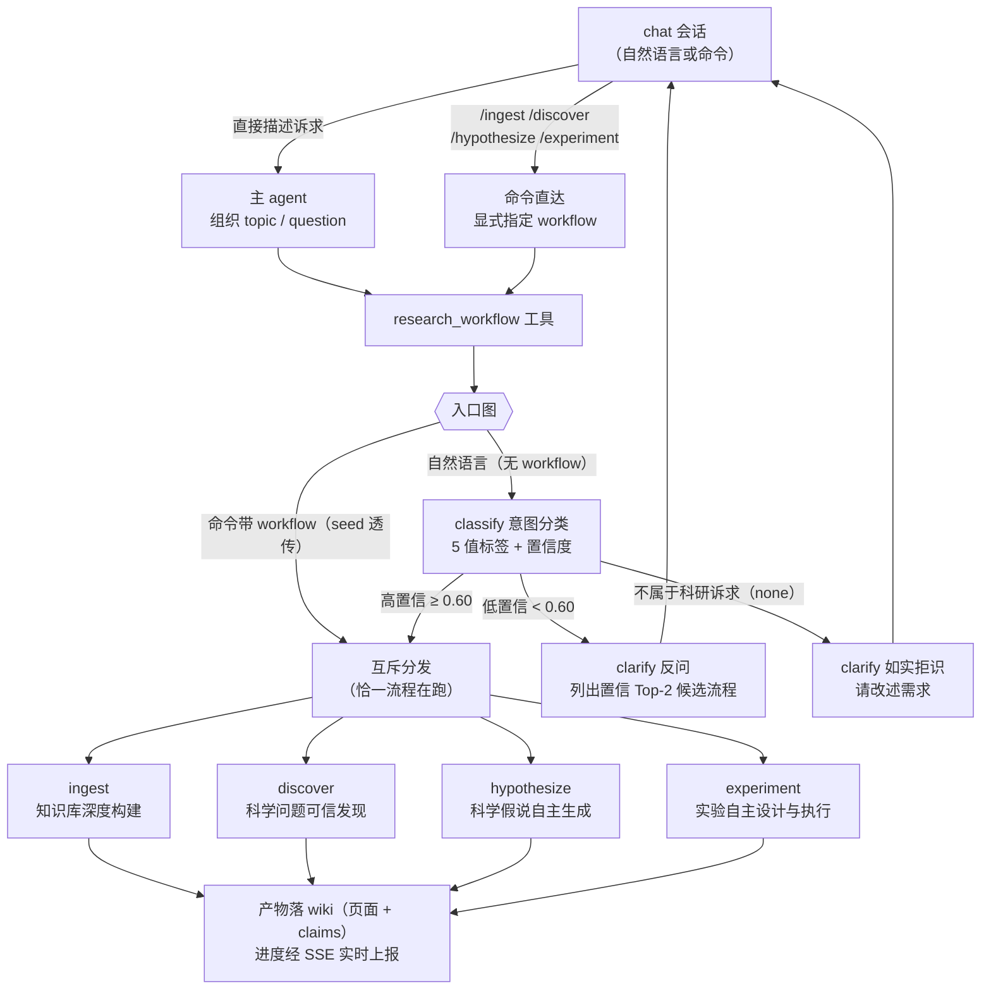

# 科研工作流（research）

科研工作流插件把四条固定科研流程接进 chat 会话：**单一入口、意图自动路由、流程互斥**。
你在对话里用自然语言描述科研诉求，或直接敲斜杠命令，插件会把它分派到对应的流程执行。

## 启用

插件默认未启用。在面板插件目录中一键启用后，**新会话**即获得 `research_workflow` 工具与
4 条命令；禁用后新会话不再可见，进行中的运行不受影响，历史回放保持原样。

## 四条流程

| 命令 | 流程 | 适用场景 |
|---|---|---|
| `/ingest` | 知识库深度构建 | 把 `/lab/uploads` 下的论文 PDF 精读整理成结构化笔记页入库 wiki |
| `/discover` | 科学问题可信发现 | 从一篇已有论文中审稿式地找出问题、弱点与研究缺口 |
| `/hypothesize` | 科学假说自主生成 | 生成新的研究想法、方向与假说 |
| `/experiment` | 实验自主设计与执行 | 为明确的问题或想法设计验证实验，并在沙箱中真实执行 |

## 入口与路由

两种触发方式汇聚到同一个执行面：

- **命令直达**：`/ingest /discover /hypothesize /experiment` 显式指定流程，不经过意图分类。
- **自然语言**：直接描述诉求（如「帮我把这篇论文的问题找出来」），主 agent 调用
  `research_workflow` 工具，入口图内的意图分类器自动判定流程；置信度不足时会**反问澄清**
  （列出最可能的候选流程供你选择），不会盲目执行。

### 路由规则速记

- **命令路径恒直达**：命令已显式指定流程，永不触发分类与澄清兜底。
- **seed 透传**：请求中已带 `workflow`（命令 / 你显式指定 / 实验流程的结果收集调用）时，
  跳过分类器直接进入对应流程。
- **多意图输入**：高置信时选首个意图执行，并在结果末尾提示「检测到后续意图 X，可继续发起」。
- **澄清后再发**：回复 clarify 提示时，重新描述诉求或直接说「用 discover 流程」，主 agent
  会带着显式流程重新调用。

## 产物与进度

> **当前版本说明**：插件骨架已上线（入口路由 + 4 命令 + 意图分类 + clarify 反问全链可用）；
> 四条流程的节点链正按计划分批接入——此阶段发起流程会收到「已受理 + 流程待接入」的占位
> 说明。下述产物/进度/人审能力随各流程实现票逐步生效。

- 发现、假说与实验报告落 **wiki**（页面 + Atomic Claims 溯源块），中间产物落 **lab**；
  页面带 frontmatter 溯源（来源插件 / 工具调用 / 流程名 / 生成时间 / 180 天陈旧标记）。
- 流程进度以裸节点名经 `research_run.progress` SSE 事件实时上报，前端按流程 + 阶段双段
  徽标呈现。
- 实验流程（experiment）在设计方案产出后设有**方案人审门禁**：方案以审批卡呈现，你批准后
  才进入沙箱执行段；拒绝可附理由进入修订（上限 3 轮）。

## 配置

| 环境变量 | 必填 | 说明 |
|---|---|---|
| `RESEARCH_MODEL` | 否 | 意图分类与流程节点的 LLM 模型 id（面板级 pin；缺省跟随 owner 默认链 primary）。也可在 Model 配置页为本插件指派端点与模型。 |

其余阈值（意图置信阈值 0.60、生成重试、扇出上限等）为代码常量，随版本发布走，不做配置面。

## 开发者注

- 规格：`docs/research/853-research-workflows-plugin.md`（#906 修订版）
- 实施拆分：#873（本 README 随 [#873·3] 骨架票落档；四流程详图各随实现票补齐）
- 意图分类评估锚点：throwaway 分支 `research/intent-classifier-eval`（40 条 bad case ×
  3 轮实测，复跑需 `LLM_API_KEY`）
