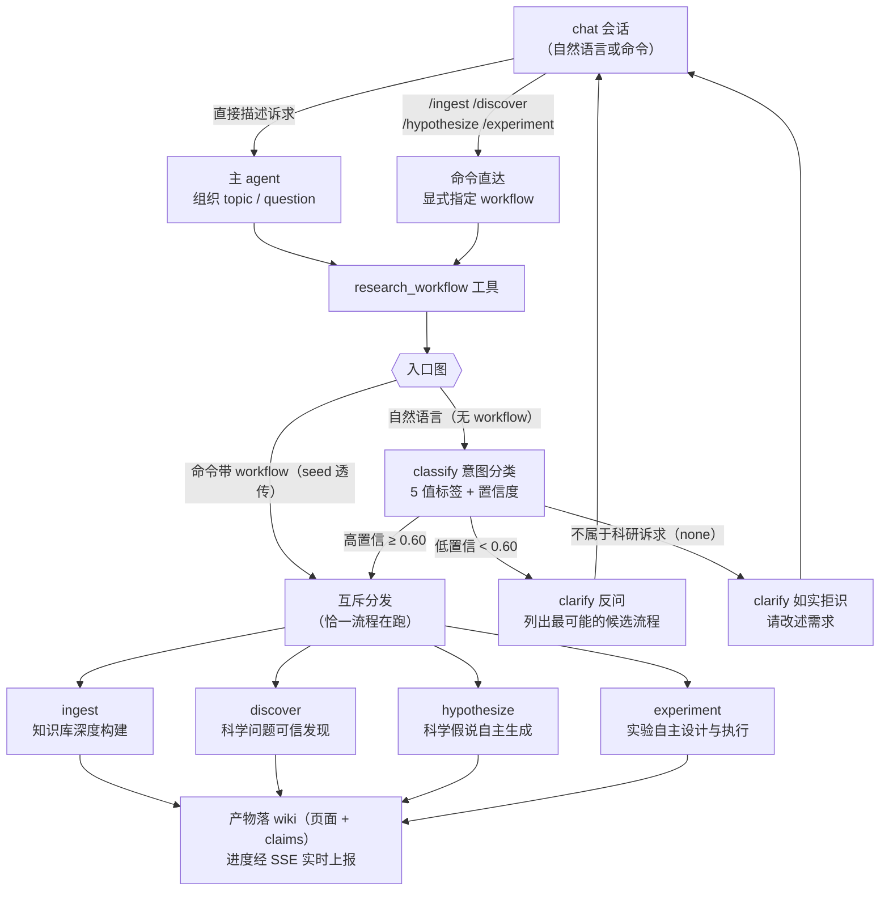
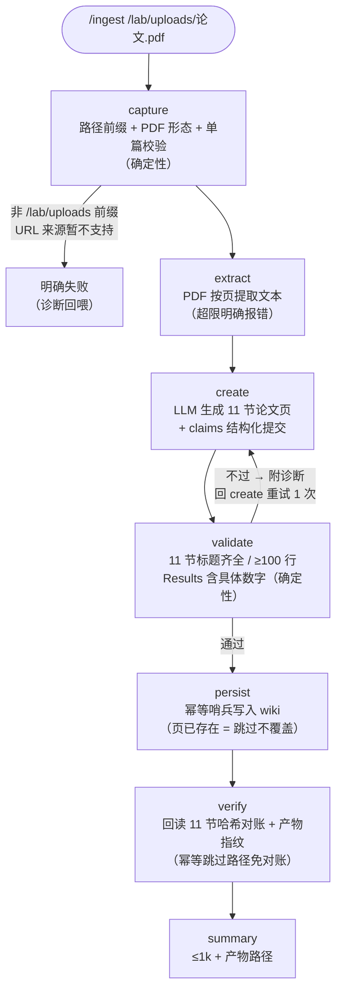
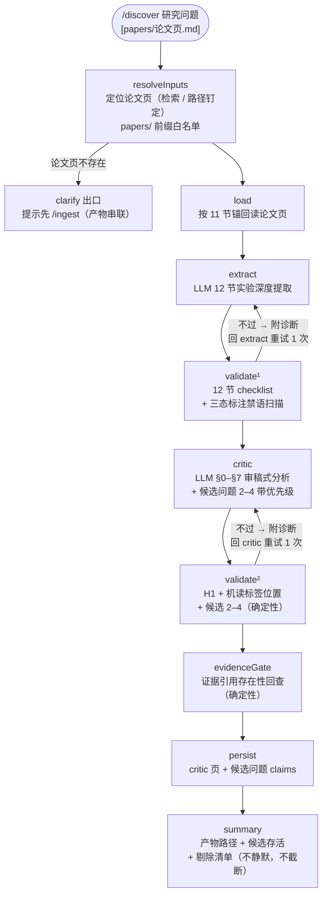
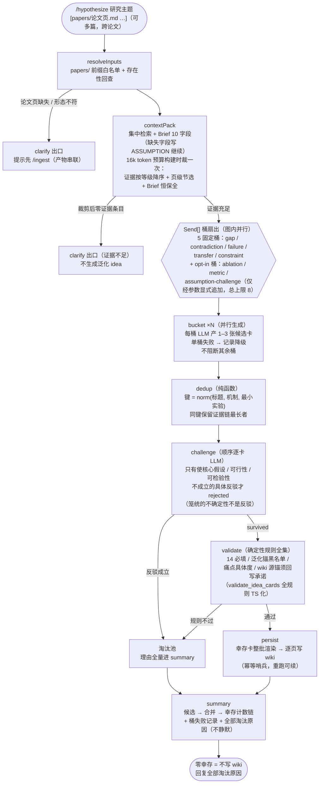
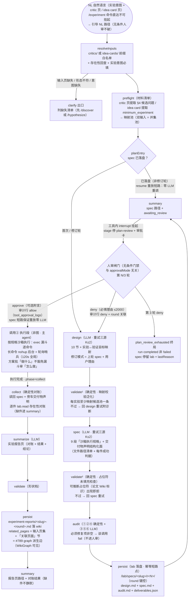

# 科研工作流（research）

科研工作流插件把四条固定科研流程接进 chat 会话：**单一入口、意图自动路由、流程互斥**。
你在对话里用自然语言描述科研诉求，或直接敲斜杠命令，插件会把它分派到对应的流程执行。

## 启用

插件默认未启用。在面板插件目录中一键启用后，**新会话**即获得 `research_workflow` 工具与
4 条命令；禁用后新会话不再可见，进行中的运行不受影响，历史回放保持原样。

## 四条流程

| 命令 | 流程 | 适用场景 |
|---|---|---|
| `/ingest` | 知识库深度构建 | 把 `/lab/uploads` 下的论文 PDF 精读整理成结构化笔记页入库 wiki |
| `/discover` | 科学问题可信发现 | 从一篇已有论文中审稿式地找出问题、弱点与研究缺口 |
| `/hypothesize` | 科学假说自主生成 | 生成新的研究想法、方向与假说 |
| `/experiment` | 实验自主设计与执行 | 为明确的问题或想法设计验证实验，并在沙箱中真实执行 |

## 入口与路由

两种触发方式汇聚到同一个执行面：

- **命令直达**：`/ingest /discover /hypothesize /experiment` 显式指定流程，不经过意图分类。
- **自然语言**：直接描述诉求（如「帮我把这篇论文的问题找出来」），主 agent 调用
  `research_workflow` 工具，入口图内的意图分类器自动判定流程；置信度不足时会**反问澄清**
  （列出最可能的候选流程供你选择），不会盲目执行。

### 路由规则速记

- **命令路径恒直达**：命令已显式指定流程，永不触发分类与澄清兜底。
- **seed 透传**：请求中已带 `workflow`（命令 / 你显式指定 / 实验流程的结果收集调用）时，
  跳过分类器直接进入对应流程。
- **多意图输入**：高置信时选首个意图执行，并在结果末尾提示「检测到后续意图 X，可继续发起」。
- **澄清后再发**：回复 clarify 提示时，重新描述诉求或直接说「用 discover 流程」，主 agent
  会带着显式流程重新调用。

## 流程详情

> 已上线：**W1 ingest**（知识库深度构建）、**W2 discover**（科学问题可信发现）、
> **W3 hypothesize**（科学假说自主生成）与 **W4 experiment**（实验自主设计与执行，
> #912 全链含方案人审门禁；审批卡面 #920/#913）。

### W1 `/ingest` 知识库深度构建（七节点链，V1 单篇）

- 产物：`papers/<kebab-case 标题>.md` 论文页（frontmatter 溯源由核心组装 + Atomic Claims 块）。
- **重跑/断线重放安全**：persist 的幂等哨兵保证同一论文不建重复页；verify 回读对账确认落盘完整。
- 生成质量门：LLM 产出经确定性校验（节结构 / 行数 / Results 数字），不过则带诊断自动重试一次，再不过即明确失败。

### W2 `/discover` 科学问题可信发现（九节点链）

- 产物：`critics/<slug>.md` critic 页（§0–§7 + `type: critique` 机读标签 + 验证候选问题进 Atomic Claims）。
- **证据可溯源**：候选问题的每条证据引用（本论文页节锚 / 其他 wiki 页 / 上传件 / 描述性引用）
  逐一回查，不可溯源的引用被剔除——剔除清单完整进 summary，本身就是溯源信息。
- 两个校验节点检查对象不同（extract 12 节 vs critic §0–§7 + H1/机读标签位置），分别把关各自生成质量。

### W3 `/hypothesize` 科学假说自主生成（八节点链 + Send[] 桶扇出）

- 产物：`idea-cards/<kebab-case 标题>.md` 假说卡页（15 字段 + `type: hypothesis` 机读标签 +
  一句假说进 Atomic Claims），逐页写入、幂等可续。
- **对抗筛选**：候选卡先经机制去重（dedup 纯函数），再逐卡对抗反驳（challenge）——只有具体
  致命反驳才淘汰；幸存卡再过确定性规则校验（validate），规则与校验同源自 `validate_idea_cards`
  全量迁移。
- **证据不足不动笔**：Context Pack 在 16k token 预算内裁剪后若零证据条目，直接 clarify 反问
  补充材料，不生成泛化 idea。
- **失败可观测**：单桶生成失败只降级不阻断，失败记录与全部淘汰原因完整进 summary。

### W4 `/experiment` 实验自主设计与执行（三调用两段式 + 方案人审）

- **三调用两段式**：调用①（图）产出方案落 lab 并必停等人审；调用②（非图）= 主 agent 按规格在
  沙箱真实执行——逐命令照常过审批漏斗，层级正交（方案审「做什么」，漏斗审「怎么做」）；
  调用③（`phase='collect'` 图）按交付物声明确定性对账、产出实验报告页落 wiki。
- **无条件人审**：方案必停审批卡（`experiment-plan` 源，`plan{title, summary, text, round}`
  内联载荷）；approve 附言随结果传达主 agent 作执行注意事项；deny 必填理由 → 回 design
  修订模式（零新图节点）；3 轮未通过 = `plan_review_exhausted` 结构化终局（非错误）。
- **幂等短路点**：spec 落盘 `/lab/specs/<slug>/r<N>/`（round 键控——每轮产物互不覆盖，重放读回用户当轮所审原文）后，interrupt 的 resume 重放跳 design/spec/audit 全部 LLM 直达挂审点；修订历史 = LangGraph resume 队列（零额外持久化）+ 历史轮审计跳过——「3 轮修订 = 3 行 round 关联」在多轮重放不破；审批审计落 `tool_approval_logs`（`toolName='experiment_plan'`，引用快照 `{planTitle, planHash, planRef, round}` 不存全文，3 轮 = 3 行 round 关联）。
- **产物**：spec/design/audit 中间产物落 lab；实验报告页 `experiment-reports/<slug>-<round>.md` 落 wiki
  （round 键控——每轮人审各得其报告页；`type: report` + frontmatter `related_pages` + 正文「关联页面」相对链接）。

## 产物与进度

> **当前版本说明**：W1（ingest）、W2（discover）、W3（hypothesize）与 W4（experiment）
> 节点链均已全链可用（见上方流程详情）；下述人审能力已生效（方案审批卡面 #920/#913）。

- 发现、假说与实验报告落 **wiki**（页面 + Atomic Claims 溯源块），中间产物落 **lab**；
  页面带 frontmatter 溯源（来源插件 / 工具调用 / 流程名 / 生成时间 / 180 天陈旧标记）。
- 流程进度以裸节点名经 `research_run.progress` SSE 事件实时上报，前端按流程 + 阶段双段
  徽标呈现。
- 实验流程（experiment）在设计方案产出后设有**方案人审门禁**：方案以审批卡呈现，你批准后
  才进入沙箱执行段；拒绝须附理由（必填，≤2000 字）进入修订（上限 3 轮）。

## 配置

| 环境变量 | 必填 | 说明 |
|---|---|---|
| `RESEARCH_MODEL` | 否 | 意图分类与流程节点的 LLM 模型 id（面板级 pin；缺省跟随 owner 默认链 primary）。 |

其余阈值（意图置信阈值 0.60、生成重试、扇出上限等）为代码常量，随版本发布走，不做配置面。

## 开发者注

- 规格：`docs/research/853-research-workflows-plugin.md`（#906 修订版）
- 实施拆分：#873（本 README 随 [#873·3] 骨架票落档；四流程详图各随实现票补齐）
- 意图分类评估锚点：throwaway 分支 `research/intent-classifier-eval`（40 条 bad case ×
  3 轮实测，复跑需 `LLM_API_KEY`）
